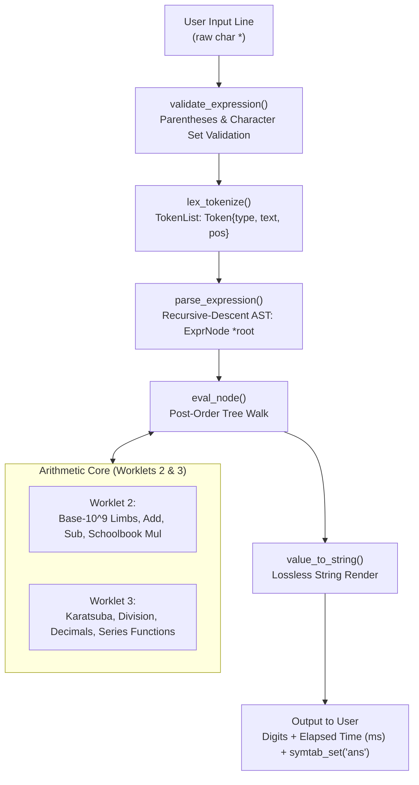

# Arbitrary-Precision Calculator — Full Expression Engine
**Mini Project 2 · Design & Implementation Plan**  
*Department of Computer Science and Engineering · COEP Technological University*

---

## 1. Project Overview

A high-performance command-line scientific calculator implemented in **ISO C from first principles** (without third-party big-number libraries such as GMP or Python `int`). 

The engine accepts arbitrary-length mathematical expressions typed as text (e.g., `a * b + (c * d - sin(e))`), builds an Abstract Syntax Tree (AST) using a recursive-descent parser, evaluates intermediate and final values with exact arbitrary precision, and prints the result alongside high-resolution execution time metrics.

### Key Capabilities
* **Arbitrary Precision:** Numbers and expressions as strings of unbounded length (limited only by available heap).
* **Full Infix Engine:** Operator precedence, associativity, and arbitrarily nested parentheses.
* **Core Arithmetic:** Exact addition ($+$), subtraction ($-$), multiplication ($\times$), division ($\div$), modulo ($\%$), power ($^\wedge$), unary signs, and factorial ($!$).
* **Mathematical Functions:** Truncated Taylor series with range reduction: `sin`, `cos`, `exp`, `ln`, `sqrt`, `abs`, `gcd`, `pow`, `mod`.
* **First-Class Types:** `BigInteger`, `BigDecimal` (significand + scale), and `Complex` ($a + bi$) supported in a single expression via automatic type promotion.
* **REPL & Variable Chaining:** Named variables (`a`, `b`, constants `pi`, `e`) and automatic result chaining through `ans`.
* **Performance Bound:** $100\text{-digit} \div 200\text{-digit}$ division completes in $< 1.0\text{ s}$.

### Implementation Prompts
All step-by-step prompts broken down by worklet and phase are available in [**`README_PROMPTS.md`**](file:///home/jayvardhan/Precision%20Calculator/README_PROMPTS.md).


---

## 2. Architecture & Data Flow Pipeline

The system is organized into a clean, layered pipeline across three distinct worklets:



### Data Contract Along the Pipeline
$$\text{char *input} \longrightarrow \text{TokenList} \longrightarrow \text{ExprNode *root (AST)} \longrightarrow \text{Value operands} \longrightarrow \text{Value result} \longrightarrow \text{char *printable}$$

---

## 3. Worklet Responsibilities Breakdown

| Worklet | Scope & Weight | Responsibilities | Key Data Structures | Key Algorithms |
| :--- | :--- | :--- | :--- | :--- |
| **Worklet 1** | **Input, Lexing, Parsing, I/O & Infrastructure**<br>*(40%)* | • `BigInteger` memory lifecycle & skeleton<br>• Line validation & whitespace trimming<br>• Lexer/Tokenizer with column position tracking<br>• Recursive-descent parser & AST construction<br>• Positional unary sign disambiguation<br>• Operator & function dispatch tables<br>• String $\leftrightarrow$ BigInteger conversion (9-digit packing)<br>• REPL menu, timing reports & test harness | `Token`, `TokenList`<br>`ExprNode` (AST)<br>`ParsedExpression`<br>`OperatorInfo[]`<br>`Timer`, heap buffers | Single-pass tokenizing scan $O(d)$<br>Precedence recursive-descent $O(t)$<br>Recursive AST cleanup<br>9-decimal-digit limb pack/unpack<br>`clock_gettime` interval timing |
| **Worklet 2** | **Number Storage & Basic Arithmetic**<br>*(30%)* | • Base-$10^9$ limb representation in `uint32_t` array<br>• Sign-and-magnitude representation ($+1, -1, 0$)<br>• Canonical zero invariant & normalization<br>• Magnitude & signed comparisons<br>• Carry/borrow propagation for addition & subtraction<br>• Schoolbook multiplication ($O(n^2)$) | `BigInteger`<br>Dynamic `uint32_t *digits`<br>(least-significant first) | Magnitude compare $O(n)$<br>Carry-propagating addition $O(n)$<br>Borrow-propagating subtraction $O(n)$<br>Schoolbook multiplication $O(n^2)$ |
| **Worklet 3** | **Evaluation, Advanced Arithmetic & Functions**<br>*(30%)* | • AST post-order evaluator & `Value` system<br>• Type promotion (Int $\rightarrow$ Decimal $\rightarrow$ Complex)<br>• Karatsuba divide-and-conquer multiplication<br>• Multi-limb long division & modulo<br>• Arbitrary-precision decimals with scale & rounding<br>• Euclidean GCD, fast exponentiation, modular power<br>• Complex arithmetic ($z_1 \cdot z_2$, division by conjugate)<br>• Taylor series with argument reduction (`sin`, `cos`, `exp`, `ln`, `sqrt`) | `Value` (tagged union)<br>`BigDecimal`, `Complex`<br>`DivisionResult`<br>`EvalContext`, `SymbolTable`<br>`FunctionEntry[]` | Post-order AST evaluation $O(t)$<br>Karatsuba $O(n^{1.585})$<br>Knuth/Limb Long Division $O(n \cdot m)$<br>Binary exponentiation $O(\log e)$<br>Euclidean GCD<br>Truncated Taylor series |

---

## 4. Core Data Structures & Interfaces

### 4.1 Number Storage: `BigInteger`
* **Base:** $B = 10^9$ (`uint32_t`), 9 decimal digits per limb.
* **Why Base-$10^9$:** A product of two limbs $(10^9 - 1)^2 < 10^{18} < 2^{63}$ fits in `uint64_t` without 64-bit overflow. A 900-digit number requires only 100 limbs.
* **Ordering:** Least significant limb first.
* **Zero Invariant:** Normalized zero is represented as `size = 1`, `digits[0] = 0`, and `sign = 0`.

```c
typedef struct {
    int        sign;     /* +1, -1, or 0 */
    size_t     size;     /* Limbs in active use */
    size_t     capacity; /* Limbs allocated */
    uint32_t  *digits;   /* Array of base-10^9 limbs */
} BigInteger;
```

### 4.2 Decimals & Complex Numbers
```c
typedef struct {
    BigInteger significand;
    int        scale;    /* 123.456 -> significand 123456, scale 3 */
} BigDecimal;

typedef struct {
    BigInteger quotient;
    BigInteger remainder;
} DivisionResult;

typedef struct {
    BigDecimal real;
    BigDecimal imag;
} Complex;
```

### 4.3 Unified Evaluator: `Value` Tagged Union
Mixed-type operations promote automatically along the chain: $\text{VAL\_INT} \rightarrow \text{VAL\_DEC} \rightarrow \text{VAL\_COMPLEX}$.
```c
typedef enum { VAL_INT, VAL_DEC, VAL_COMPLEX } ValueType;

typedef struct {
    ValueType type;
    union {
        BigInteger i;
        BigDecimal d;
        Complex    c;
    } as;
} Value;
```

### 4.4 Lexer & AST Nodes
```c
typedef enum {
    TK_NUMBER, TK_IDENT, TK_OP,
    TK_LPAREN, TK_RPAREN, TK_COMMA, TK_END
} TokenType;

typedef struct {
    TokenType type;
    char     *text;
    size_t    pos; /* Source column for error carets */
} Token;

typedef enum {
    NODE_NUMBER, NODE_VAR, NODE_UNARY, NODE_BINARY, NODE_CALL
} NodeType;

typedef struct ExprNode {
    NodeType type;
    size_t   pos;
    union {
        Value number;
        char *var_name;
        struct { OpCode op; struct ExprNode *left, *right; } bin;
        struct { OpCode op; struct ExprNode *operand;      } un;
        struct { int fn_id; size_t argc; struct ExprNode **args; } call;
    } as;
} ExprNode;
```

---

## 5. Expression Grammar & Precedence

The recursive-descent parser implements this grammar directly, with structural precedence:

```ebnf
expression -> term      (( '+' | '-' ) term)*
term       -> power     (( '*' | '/' | '%' ) power)*
power      -> unary     ( '^' power )?               (* right-associative *)
unary      -> ( '+' | '-' ) unary | postfix          (* positional sign disambiguation *)
postfix    -> primary   ( '!' )*                     (* factorial *)
primary    -> NUMBER
            | IDENT
            | IDENT '(' arglist ')'
            | '(' expression ')'
arglist    -> expression ( ',' expression )*
```

### Operator Precedence Table

| Level | Operators | Associativity | Arity | Node Produced |
| :---: | :---: | :---: | :---: | :---: |
| **1** | `+`, `-` (binary) | Left | 2 | `NODE_BINARY` |
| **2** | `*`, `/`, `%` | Left | 2 | `NODE_BINARY` |
| **3** | `^` | Right | 2 | `NODE_BINARY` |
| **4** | `+`, `-` (unary sign) | Right | 1 | `NODE_UNARY` |
| **5** | `!` (factorial) | Postfix | 1 | `NODE_UNARY` |
| **6** | `( )`, `fn(...)` | — | $n$ | `NODE_CALL` / grouping |

---

## 6. Implementation Phases

```
┌────────────────────────────────────────────────────────────────────────┐
│ Phase 1: Core Foundation & Data Structures (Types, Memory, Invariants) │
└──────────────────────────────────┬─────────────────────────────────────┘
                                   │
                                   ▼
┌────────────────────────────────────────────────────────────────────────┐
│ Phase 2: Worklet 2 — Number Storage & Basic Arithmetic (Add, Sub, Mul) │
└──────────────────────────────────┬─────────────────────────────────────┘
                                   │
                                   ▼
┌────────────────────────────────────────────────────────────────────────┐
│ Phase 3: Worklet 1 — Lexer, Recursive-Descent Parser, AST & I/O        │
└──────────────────────────────────┬─────────────────────────────────────┘
                                   │
                                   ▼
┌────────────────────────────────────────────────────────────────────────┐
│ Phase 4: Worklet 3 — Advanced Arithmetic (Karatsuba, Division, Dec)    │
└──────────────────────────────────┬─────────────────────────────────────┘
                                   │
                                   ▼
┌────────────────────────────────────────────────────────────────────────┐
│ Phase 5: Worklet 3 — Mathematical Functions & Symbol Engine            │
└──────────────────────────────────┬─────────────────────────────────────┘
                                   │
                                   ▼
┌────────────────────────────────────────────────────────────────────────┐
│ Phase 6: Expression Evaluation & Type Promotion Engine                 │
└──────────────────────────────────┬─────────────────────────────────────┘
                                   │
                                   ▼
┌────────────────────────────────────────────────────────────────────────┐
│ Phase 7: REPL Control Loop (17-Step Execution Cycle)                   │
└──────────────────────────────────┬─────────────────────────────────────┘
                                   │
                                   ▼
┌────────────────────────────────────────────────────────────────────────┐
│ Phase 8: Testing, Verification & Benchmarking Suite                    │
└────────────────────────────────────────────────────────────────────────┘
```

### Phase 1: Core Foundation & Memory Lifecycle
* Define constants (`BASE = 1000000000U`, `BASE_DIGITS = 9`).
* Implement struct definitions and strict lifecycle handlers:
  * `bigint_init()`, `bigint_init_capacity()`, `bigint_reserve()`, `bigint_resize()`, `bigint_clear()`, `bigint_free()`.
  * `free_expr_node()` (recursive AST cleanup, ensuring zero leaks and no aliasing).

### Phase 2: Worklet 2 — Storage & Basic Arithmetic Primitives
* **Normalization:** Implement `bigint_normalize()` to strip leading zeroes and maintain the canonical zero invariant.
* **Comparison:** Implement `bigint_compare_abs()` ($O(1)$ on size difference, $O(n)$ on limbs) and signed `bigint_compare()`.
* **Addition & Subtraction:**
  * Magnitude addition with 64-bit carry propagation: `bigint_add_abs()`.
  * Magnitude subtraction with borrow propagation: `bigint_sub_abs()`.
  * Signed wrappers: `bigint_add()`, `bigint_sub()`.
* **Multiplication:** Implement `bigint_mul_schoolbook()` ($O(n^2)$) accumulating products in 64-bit limb cells.

### Phase 3: Worklet 1 — Lexing, Parsing, AST & String I/O
* **Validation:** Implement `validate_expression()` for illegal characters and balanced parentheses.
* **Lexer:** Implement `lex_tokenize()` producing `TokenList` with column indices.
* **Recursive-Descent Parser:** Implement `parse_expression()`, `parse_term()`, `parse_power()`, `parse_unary()`, `parse_postfix()`, and `parse_primary()`.
* **Positional Sign Disambiguation:** Differentiate unary vs binary signs by grammar position without backtracking.
* **Lossless Conversions:**
  * `bigint_from_string()`: Pack decimal string into 9-digit base-$10^9$ limbs.
  * `bigint_to_string()`: Lossless formatting (MSB unpadded, lower limbs `%09u`).

### Phase 4: Worklet 3 — Advanced Arithmetic, Decimals & Complex Numbers
* **Karatsuba Multiplication:**
  * Split limbs at $k = \lceil n/2 \rceil$: $z_2 = a_1 b_1$, $z_0 = a_0 b_0$, $z_1 = (a_1 + a_0)(b_1 + b_0) - z_2 - z_0$.
  * Selector `bigint_mul()`: Auto-switch between Schoolbook and Karatsuba based on measured crossover point.
* **Multi-Limb Long Division:**
  * Knuth Algorithm D / trial digit long division: `bigint_divide()` producing `DivisionResult{quotient, remainder}`.
  * Guarantee $100\text{-digit} \div 200\text{-digit}$ bound completes in $< 1\text{ s}$.
  * Implement `bigint_mod()` and Euclidean `bigint_gcd()`.
* **Arbitrary-Precision Decimals:**
  * Implement `BigDecimal` operations (`decimal_add`, `decimal_sub`, `decimal_mul`, `decimal_div`, `decimal_round`).
* **Complex Numbers:**
  * Implement arithmetic on $z = a + bi$ with division by the conjugate.

### Phase 5: Worklet 3 — Mathematical Functions & Symbol Engine
* **Symbol Table & Context:**
  * Symbol resolution for variables (`a`, `b`, ...), mathematical constants (`pi`, `e`), and previous result chaining (`ans`).
* **Taylor Series with Range Reduction:**
  * $\sin(x), \cos(x)$: Range reduction modulo $2\pi$, Maclaurin series expansion.
  * $\exp(x)$: Integer/fraction split and Taylor expansion.
  * $\ln(x)$: Argument reduction and logarithmic series.
  * $\text{sqrt}(x)$: Arbitrary-precision Newton-Raphson iteration.
* **Table-Driven Dispatch:**
  * `OPERATORS[]` and `FUNCTIONS[]` tables mapping names to arity, precedence, and function pointers.

### Phase 6: Expression Evaluator & Type Promotion
* **Type Promotion:** Implement `value_promote()` ensuring $\text{VAL\_INT} \rightarrow \text{VAL\_DEC} \rightarrow \text{VAL\_COMPLEX}$.
* **Post-Order AST Evaluator:** Implement `eval_node()`:
  * Recursively evaluates children before operating on parent node.
  * Guard against infinite recursion with `ctx->depth` limit.
  * Return runtime errors as `EvalError{code, position}`.

### Phase 7: REPL Control Loop (17-Step Pipeline)
Implement the full seventeen-step interactive REPL loop:
1. `display_menu()`
2. `get_operation_choice()`
3. Check exit condition (`choice == EXIT`)
4. `read_input_line()`
5. `validate_expression()`
6. `lex_tokenize(&tokens)`
7. `parse_expression(&tokens)`
8. Handle parse errors: print column position caret `^`
9. `eval_context_init(&ctx)`
10. `timer_start(&timer)` *(Measurement brackets arithmetic evaluation only)*
11. `eval_node(root, &ctx)`
12. `timer_stop(&timer)`
13. Check and report evaluation errors
14. `value_to_string(&result)`
15. Display exact digits and `timer_elapsed_ms()`
16. Save result to `symtab_set("ans")`, free temporary strings
17. Cleanup AST via `free_expr_node(root)` and `token_list_free(&tokens)`

### Phase 8: Testing, Benchmarking & Verification
* **Unit Testing:** Individual test runners for lexer, parser, storage, and arithmetic operations.
* **Differential Testing:** Test against GNU `bc` and Python `int` across thousands of randomized expressions.
* **Negative Test Suite:** Confirm proper rejection and caret placement for malformed expressions (unbalanced parentheses, missing operands, unknown functions, division by zero).
* **Performance Profiling:** Verify Karatsuba crossover curve and confirm the $100\text{-digit} \div 200\text{-digit} < 1\text{ s}$ requirement.
* **Memory Leak Audit:** Full test run under `valgrind --leak-check=full` and AddressSanitizer (`-fsanitize=address,undefined`).

---

## 7. Error Reporting Specification

Errors report the exact character column position to provide clear visual feedback:

```text
> 2 * (3 + sin(4)
         ^
ParseError [ERR_UNBALANCED_PAREN at col 5]: unclosed '(' opened at column 5
```

---

## 8. Development & Build Specifications

* **Language Standard:** ISO C (C99 / C11).
* **Dependencies:** Standard C library only (`<stdio.h>`, `<stdlib.h>`, `<string.h>`, `<stdint.h>`, `<time.h>`).
* **Platform Independence:** Timing isolated inside `Timer` struct using `clock_gettime()`.
* **Recommended Build Flags:**
  ```bash
  gcc -Wall -Wextra -pedantic -std=c11 -O2 big_integer_calculator.c -o calculator
  ```
* **Debug & Sanitizer Build:**
  ```bash
  gcc -Wall -Wextra -pedantic -std=c11 -g -fsanitize=address,undefined big_integer_calculator.c -o calculator_debug
  ```

